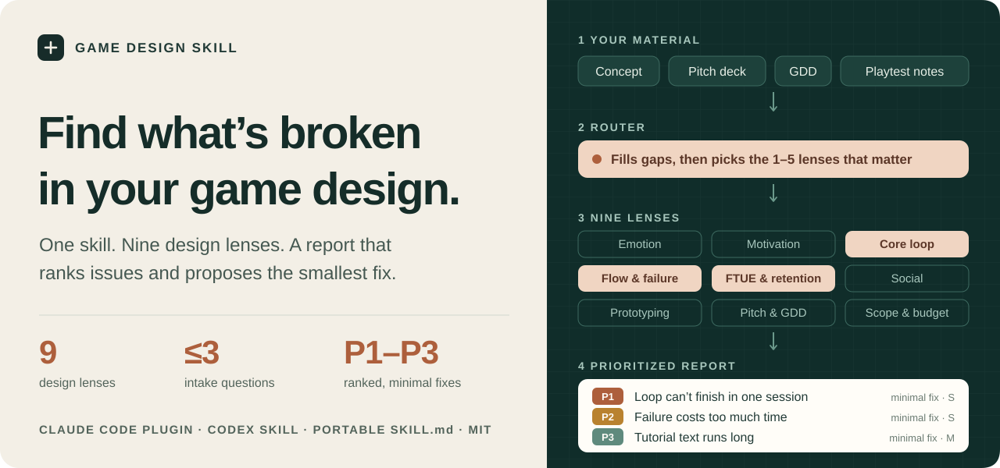
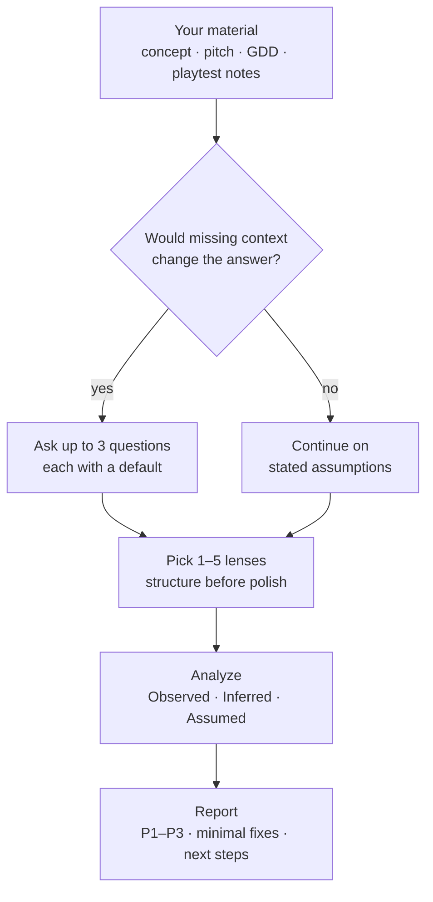

# Game Design Skill

<picture>
  <source media="(max-width: 600px)" srcset="docs/assets/readme-hero-mobile.svg">
  
</picture>

<p align="center">
  <a href="#quick-start">Quick start</a> ·
  <a href="#how-it-works">How it works</a> ·
  <a href="#the-nine-lenses">Lenses</a> ·
  <a href="#what-a-report-looks-like">Example report</a> ·
  <a href="#compatibility">Compatibility</a> ·
  <a href="#documentation">Docs</a>
</p>

[](https://github.com/kristianrolando/game-design-skill/actions/workflows/ci.yml)
[](LICENSE)
[](https://github.com/kristianrolando/game-design-skill/releases/tag/v0.1.0)

**A design review from a senior game designer, packaged as one agent skill.** Share a concept, feature spec, pitch deck, GDD, prototype notes or playtest feedback. The skill fills in missing context, picks the design lenses that fit your question, and returns a prioritized report with minimal fixes and next steps.

| You bring | The skill does | You get |
| --- | --- | --- |
| Concept, spec, pitch deck, GDD or playtest notes | Fills context gaps, picks the right lenses, ties findings to evidence | Ranked issues, minimal fixes with checks, next steps |

Works as a Claude Code plugin or direct skill, as a Codex skill, and in other agents that read `SKILL.md` files. The skill text is host-neutral. See [compatibility](#compatibility).

## Quick start

**1. Install** with one route per host. Both routes below were verified against the public repository ([evidence](docs/evidence/public-routes-2026-11-03.md)).

Claude Code plugin:

```text
/plugin marketplace add kristianrolando/game-design-skill
/plugin install game-design-skill@game-design-tools
```

Direct skill for Claude Code, Codex and other agents (choose the host in the installer):

```sh
npx skills add kristianrolando/game-design-skill --skill game-design-skill
```

**2. Ask** for a review in your host:

| Host | Prompt |
| --- | --- |
| Claude Code plugin | `/game-design-skill:game-design-skill Audit the core loop of this concept: ...` |
| Claude Code direct skill, Antigravity, Cursor, Cline | `/game-design-skill Review our FTUE script and tell me where players will drop.` |
| Codex | `Use $game-design-skill to turn these notes into a one-page design doc.` |
| Gemini CLI, Copilot, OpenCode | `Use the game-design-skill skill: is this scope realistic for two part-time developers in 9 months?` |

<details>
<summary><strong>Install from a local checkout, or without installing</strong></summary>

| Host | Route |
| --- | --- |
| Claude Code, one session without installing | `claude --plugin-dir ./game-design-skill` |
| Claude Code, direct skill | Copy `skills/game-design-skill` to your project's `.claude/skills/` |
| Codex and other `.agents/skills/` hosts | Copy `skills/game-design-skill` to your project's `.agents/skills/` |
| Any agent with file access | Ask it to read `skills/game-design-skill/SKILL.md` and follow it |

Locations for all hosts, and how to activate the skill in each, are in the [host guide](docs/hosts.md).

</details>

## How it works



1. **Intake**: reads the material and checks genre, platform, target player and production stage. If something missing would change the answer, it asks up to three short questions with defaults; otherwise it states assumptions and continues.
2. **Choose lenses**: one lens for a quick question, two or three for a standard review, up to five for a full audit, ordered structure before polish and matched to the production stage.
3. **Analyze**: findings tied to evidence in the material, each labeled Observed, Inferred or Assumed.
4. **Report**: summary, findings by lens, a priority table (P1 to P3 with effort), minimal-fix recommendations with a way to verify each, and next steps.

## The nine lenses

Each lens family is a separate file, loaded only when the router selects it, so a typical review reads two or three of them.

| | Lens family | Typical questions |
| :---: | --- | --- |
| 🎭 | [Emotional direction](skills/game-design-skill/references/emotional-direction.md) | What is the player fantasy? Does the tone hold together? What will players remember? |
| 💡 | [Player motivation](skills/game-design-skill/references/motivation.md) | Why do players keep going? Who is this for, and who will bounce? Why is a feature unused? |
| 🔁 | [Core loop and pillars](skills/game-design-skill/references/core-loop-pillars.md) | What is the repeatable engine? Which features are orphans? Do the pillars decide anything? |
| 📈 | [Flow, fairness and failure](skills/game-design-skill/references/flow-fairness-failure.md) | Where is it boring or overwhelming? Why does it feel unfair? Is failure worth retrying? |
| 🚪 | [FTUE and retention](skills/game-design-skill/references/ftue-retention.md) | Does onboarding hook players? Is there always a next goal? Are return reasons healthy? |
| 🤝 | [Multiplayer and social](skills/game-design-skill/references/multiplayer-social.md) | Do players need each other? Are social foundations in place? Is the ladder fair? |
| 🧪 | [Prototyping](skills/game-design-skill/references/prototyping.md) | What is the riskiest assumption? What should we test first, and when do we stop? |
| 📄 | [Pitch and GDD](skills/game-design-skill/references/pitch-gdd.md) | Write a one-page design doc. Is the GDD healthy? Is the pitch deck convincing? |
| 🧮 | [Scoping and budget](skills/game-design-skill/references/scoping-budget.md) | What do we build first? Which skills are missing? How long and how much, roughly? |

## What a report looks like

An excerpt from a recorded trial: a core loop audit of *Night Harbor*, a cozy mobile fishing concept written for the test.

> **Summary (excerpt):** The biggest problem is that the numbers stop the loop from finishing. Energy gives 5 casts but the cooler holds 8, so a player can't complete one trip (cast, fill, sell, upgrade) without waiting about an hour or paying.
>
> | ID | Issue | Lens | Severity | Confidence | Effort |
> | --- | --- | --- | --- | --- | --- |
> | F1 | Energy (5) is smaller than the cooler (8): a trip can't finish without waiting or paying; paid refills monetize that friction | Core loop / Retention | P1 | Inferred | S |
> | F6 | A missed tap burns scarce energy | Flow and fairness | P2 | Assumed | S |
> | F3 | The cast loop has no variety and wouldn't hold up without the meta | Core loop | P2 | Inferred | M |
>
> **Minimal fix, F1:** Make one energy unit buy one whole trip, not one cast. **Check:** on paper, run 10 simulated breaks of 5-10 minutes each. Every one should end at the dock.

Full, unedited trial records:

- [Core loop audit of a cozy fishing concept](docs/examples/core-loop-audit-night-harbor.md) (Claude subagent), including an intake check.
- [FTUE review of a deckbuilder prototype](docs/examples/ftue-review-ember-pact-codex.md) (Codex CLI, native skill discovery).
- [Social design review of a co-op survival concept](docs/examples/social-review-raft-rally-claude-plugin.md) (Claude Code plugin).
- [One-page design doc for a cozy narrative concept](docs/examples/one-page-gdd-lantern-post-claude-skill.md) (Claude Code direct skill, develop mode).
- [Emotional direction review of a cozy-horror farming concept](docs/examples/emotional-direction-gravekeepers-garden-claude.md), [crafting adoption review of a live mobile RPG](docs/examples/motivation-guild-forge-claude.md) and [prototype plan for a VR voice puzzle game](docs/examples/prototyping-plan-echo-rooms-claude.md) (Claude Code direct skill).

Together the trials load all nine lens families at least once.

## Compatibility

✅ observed in a recorded check · 📄 documented route only

| Host / component | Route | Evidence and limits |
| --- | --- | --- |
| ✅ **Claude Code** | Included plugin or direct skill | Manifests validate; the GitHub marketplace adds, the plugin installs and exposes the skill, and the Skills CLI copies the skill into `.claude/skills/` (CLI 2.1.287). Model sessions invoked both the plugin skill and the direct skill and returned reports in the template. |
| ✅ **Codex** | Direct skill; optional `agents/openai.yaml` metadata | Codex CLI 0.166 discovered the project-local skill and produced a report in the template. |
| 📄 **Antigravity, Cursor, Gemini CLI, GitHub Copilot, OpenCode, Cline** | Direct skill in the [documented folders](docs/hosts.md) | Documented routes only; not exercised for this package. |
| 📄 Other filesystem agents | Explicitly read `SKILL.md` | Portable fallback; native discovery not verified. |
| 📄 Plain chat | Paste or upload SKILL.md and the relevant lens file | Works as instructions; no on-demand lens loading. |

Details and dates: [validation evidence](docs/validation.md).

## Documentation

| Start here | Go deeper |
| --- | --- |
| [Host installation and activation](docs/hosts.md) | [Architecture and trade-offs](docs/architecture.md) |
| [Recorded trials](docs/examples/core-loop-audit-night-harbor.md) | [Validation evidence and limits](docs/validation.md) |
| [Contributing with any agent](CONTRIBUTING.md) | [File map](docs/file-map.md) |
| [Publication checklist](docs/releasing.md) | [Automated checks](docs/ci.md) |

## Checks

```sh
python3 -m unittest discover -s tests -v
```

The tests validate the skill frontmatter, lens table and links, the six required sections in each lens file, the report format and recorded examples, the plugin manifests, release notes, workflows, license copies, host-neutral wording, the README artwork, and, when the reference bundle is present locally, that no long passage is shared with it. The banner in `docs/assets/` is plain, editable SVG with wide and narrow layouts, its own background for light and dark themes, system fonts, and no scripts or external resources.

## Credits and provenance

The design frameworks named in the lenses belong to their authors, including Self-Determination Theory (Deci and Ryan), Flow (Csikszentmihalyi), player types (Bartle), the Fogg Behavior Model (Fogg), attribution theory (Weiner), fast and slow thinking (Kahneman), the Zeigarnik effect and the monomyth (Campbell).

The choice of topics was informed by the Game Design Skills Bundle by Stanislav Stankovic, which is licensed PolyForm Noncommercial 1.0.0. No text from that bundle is included here. This package's instructions, structure and wording are original and licensed under MIT.

## License

[MIT](LICENSE) · Copyright (c) 2026 Kristian Rolando Limantara.
